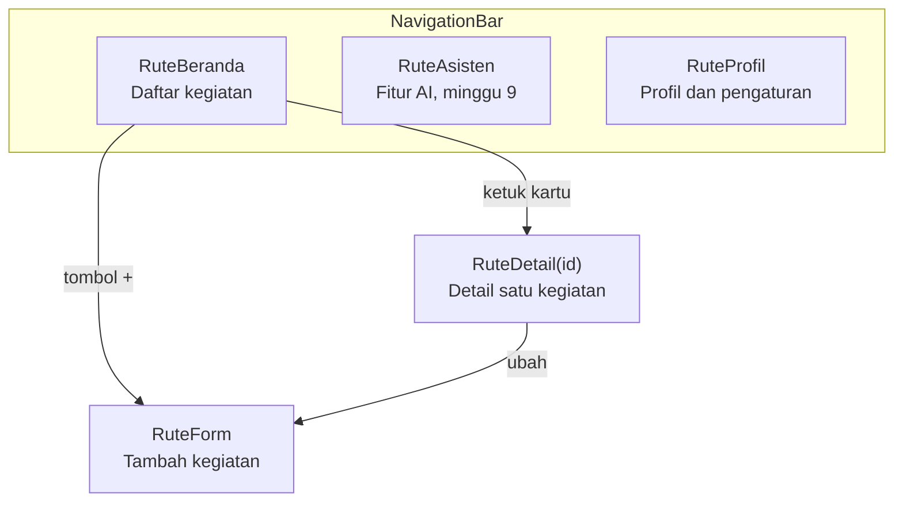

# Tema 16. Presensi Kegiatan Himpunan

## Identitas Kelompok

| No. | Nama Anggota                | NIM       | Jabatan |
| --- | --------------------------- | --------- | ------- |
| 1   | Muhammad Irfan Ramadhan     | 124140159 | Ketua   |
| 2   | Muhammad Arfa Raditya       | 124140015 | Anggota |
| 3   | Jeremi Pison Efrat Sianturi | 124140195 | Anggota |

## Riwayat Perubahan Minggu Ini (Modul 2)

| Nama | File | Perubahan |
| --- | --- | --- |
| Muhammad Arfa Raditya | `model/Kegiatan.kt`, `Presensi.kt`, `StatusKegiatan.kt` | Membuat model data kegiatan, presensi, dan status. |
| Muhammad Irfan Ramadhan | `data/Sumber.kt`, `SumberKegiatanPalsu.kt` | Membuat kontrak `Sumber<T>` dan sumber data kegiatan palsu. |
| Jeremi Pison Efrat Sianturi | `gradle/libs.versions.toml`, `shared/build.gradle.kts`, `SumberKegiatanPalsuTest.kt`, `README.md` | Menambah dependensi Coroutines, unit test `ambil()` dan `pantau()`, serta dokumentasi. |

## Ringkasan Modul 2

- `Kegiatan` menyimpan `id`, `nama`, `deskripsi`, `lokasi`, `tanggal`, dan `status`.
- `StatusKegiatan` memiliki tiga status: `Dijadwalkan`, `Berlangsung`, `Selesai`.
- `Sumber<T>` menyediakan `suspend fun ambil(id)` untuk mengambil satu data dan `fun pantau(id): Flow<T>` untuk memantau perubahan data.
- `SumberKegiatanPalsu` menggunakan `delay()` untuk mensimulasikan proses asynchronous.
- `pantau()` mengirim status berurutan melalui `emit()`: `Dijadwalkan` -> `Berlangsung` -> `Selesai`.
- Pengujian menggunakan `runTest`, `kotlin.test`, dan virtual time sehingga tidak menunggu `delay()` secara nyata.

## Riwayat Perubahan Minggu Ini (Modul 3)

| Nama | File | Perubahan |
| --- | --- | --- |
| Muhammad Irfan Ramadhan (124140159) | `ui/DaftarKegiatan.kt` | Membuat daftar kegiatan dengan `LazyColumn` dan sorting tanggal. |
| Muhammad Arfa Raditya (124140015) | `ui/KartuKegiatan.kt`, `ui/LabelStatusKegiatan.kt` | Membuat kartu kegiatan dan label status. |
| Jeremi Pison Efrat Sianturi (124140195) | `ui/LayarUtama.kt`, `App.kt`, `gradle/libs.versions.toml`, `shared/build.gradle.kts`, `README.md` | Menyatukan layar utama, integrasi data, `FloatingActionButton`, dependensi ikon, dan dokumentasi. |

## Ringkasan Modul 3

- `LayarUtama` memakai `Scaffold` untuk menampilkan judul "Presensi Kegiatan Himpunan", keterangan jumlah kegiatan, daftar kegiatan, dan `FloatingActionButton` tambah kegiatan.
- `App` mengisi layar dengan 12 data dari `SumberKegiatanPalsu.semua()` tanpa data tempelan.
- `DaftarKegiatan` menampilkan data dengan `LazyColumn` dan mengurutkannya berdasarkan tanggal secara menurun.
- `KartuKegiatan` menampilkan detail kegiatan dan `LabelStatusKegiatan` menampilkan status `Dijadwalkan`, `Berlangsung`, atau `Selesai`.
- Build `:androidApp:assembleDebug` dan pengujian `SumberKegiatanPalsuTest` berhasil.

## Peta Navigasi (Modul 5)

- Rute bertipe ada di `nav/Rute.kt`; detail membawa `id` kegiatan, bukan objeknya.
- Pindah tab memakai `pindahTab()` (`nav/PindahTab.kt`) dengan `popUpTo` + `saveState`, `launchSingleTop`, dan `restoreState`.
